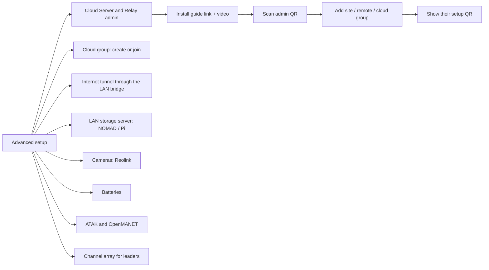

# Your Community Communications: UI and menu reorganisation plan

**Built (2026-11-18)**: phases 1 to 7 are in the app (see UPDATES.md and the "As built" notes at the end). The
plan below is kept as the record of what was decided. Based on the code as it was then (0.1.459238).

Kept as rules throughout:
- Simple modes keep the full map.
- Advanced and Region features (today's Specialised menus) stay off by default and travel in the setup QR code.
- Terminology: **Anchored** = any device on stable power (mains). It is a power setting, not a role. The
  internet relay is the **Cloud Server**.
- Android 4.1 compatible (plain Java, no AndroidX, dialogs and drawn icons that work on old phones).
- The device role can be changed later and travels in the setup QR code.

## Decisions (2026-11-18)

the owner's answers to the first draft's questions:

| # | Decision | Effect on the plan |
|---|---|---|
| 1 | Team leader is a **tick inside Phone radio**, not a role | "Team leader" removed from the roles; a "I lead a team" tick in Phone radio pre-ticks the team features |
| 2 | Remote member is **not a role**: it's the **Join the Cloud Server** wizard | Removed from the roles; the Advanced setup wizard stays |
| 3 | TV / display is **not muted** by default (it can talk) | TV role has PTT on |
| 4 | Commander tablet role is offered on **phones and tablets** | No screen-size check on the role |
| 5 | Keep the **explainer page** for the two modes / UI differences (Advanced vs Simple) | Wizard keeps it, before the group type step |
| 6 | (Open) More screen vs a single regrouped menu | Still question 1 below |
| 7 | The setup QR can set **everything**, role included, and applies **without asking** | New: the QR can set the callsign and say whether the phone may edit it or it is **locked** (new feature, field "nameLock") |
| 8 | Advanced features = a **checklist, all off by default**, with a **More** option for the more obscure items | The Advanced setup wizards hang off that checklist |
| 9 | Rename Specialised menus to **Advanced and Region features** | Region items (VicEmergency, Melbourne trains, station names, ARTC) grouped as Region features |
| 10 | **Replace the old wizard outright**, once the other changes are in | No "old or new wizard" choice |
| — | **Anchored is not a role**: any device can be anchored (stable power) | "Anchored (on stable power)" lives under the battery / power options; no role turns it on by itself |
| — | **Anchored button** in the title bar (radio home, map home and full map) while plugged in | Shows whether this device is anchored, and one tap sets or clears it (see 3.4). **Built** in 0.1.462161 |
| 11 | **Map home is the default screen** | Every phone radio and commander starts on the map home; Public intercom and TV / display keep their own screens; the radio buttons home stays one tap away (title bar toggle) |
| 12 | **Shortcuts**: one dropdown / page with **all** the shortcut buttons, instead of the Advanced / Simple sets on the home screen | The radio home gets a **Shortcuts** button in place of a couple of buttons; the Shortcuts page shows the current state at the top (see 3.5) |
| 13 | **Simple / Advanced is switched from the Channels page**: a Simple channels page and an Advanced channels page | Advanced channels links to DRYAD and the other key tools (see 3.6) |
| 14 | On both channel pages each channel is **visible or hidden**, with a small "show on the home screen" button | Hidden channels stay set up (and can be listened to) but don't appear on the home radio row or PTT buttons |
| 15 | **"Video feed" is renamed "Video feed"**, and a 30 s tappable notice says "X has started their video feed" | **Built** (see the update log) |

---

## 1. Inventory: what exists today

### 1.1 Modes (Prefs.appMode)

| Mode | What it is now | Home screen | Notes |
|---|---|---|---|
| Advanced | Everything: radio, DRYAD, maps, codes | Radio buttons home (or map home) | Default for new installs that pick it |
| Intercom | Wall-mounted phone or tablet, rooms | IntercomActivity (no title bar, menu dots behind PIN) | Records all voice, Friends quick profile |
| Scouts, Staff, 4WDing, Friends convoy, Caravan / camping | Simple modes: one private key (A) + Public (+ Cloud) | Simple radio home (Private / Public / Cloud) | No DRYAD, Pigpen, OpenMANET, NOMAD; Keys screen instead of the Channels page; own quick buttons |

Separate *views* rather than modes: **commander view** (any tablet in landscape: map + Contacts/Channels side
panel), **map home** (home toggle in the title bar), **full map** start, **TV mode** (TvActivity; Android TV opens
it by itself).

### 1.2 Screens (activities)

| Screen | Reached from now | What it does | Used by roles |
|---|---|---|---|
| MainActivity | Launcher | Radio home or map home; commander view on tablets | All except intercom |
| ChannelsActivity | Home "Channels" | Channels A–H, Public, OpenMANET, Cloud; listen, pin, catch-up, tunnel icons | Phone (advanced), commander |
| KeysActivity | Home "Channels" in simple modes | Private key, Public key, listen key, Cloud group… | Phone (simple) |
| CloudGroupActivity | Channels / Keys > Cloud group… ; links ycc://cloud | Cloud group, Cloud Server, share link / QR, Scan QR, receive-only code, location opt-in | Phone, commander |
| ContactsActivity | Home "Contacts" | Everyone heard, status, battery, distance, notes, private contacts | All |
| ChatActivity | Home "Chat", title bar | Chat, reports, files, map points; filter by kind and channel; sources | All |
| ReportsActivity / ReportComposeActivity | Chat > Report… | Report templates and sending | Phone, leader |
| MapActivity | Home "Map" / "Full map" | Full map, layers, POIs, routes, search, tiles, live layers, ruler, compass | All |
| CompassActivity | Map compass | Baseplate compass | Phone |
| FilesActivity | Menu > Data / files | Send location, photos, files, tile management, imports | Phone, commander |
| TrexMapsActivity | Map menu / Data (specialised menu) | T.REX Arms topo import and sharing | Phone, commander |
| AudioActivity | Menu > Audio | Recordings, playback, tests | Phone, commander |
| StreamsActivity | Menu > Radio streams (if Internet audio on) | Internet scanner feeds | Phone |
| DryadActivity, DryadGenerateActivity, DryadShareActivity, DryadExplainedActivity | Menu > DRYAD (advanced) | Modern DRYAD sheets | Phone (advanced), leader |
| PigpenActivity, EnigmaActivity, CwSettingsActivity, ChallengeActivity | DRYAD screen / home | Pigpen, Enigma page, CW (Morse), challenge and response | Phone (advanced) |
| QrShowActivity / QrScanActivity | Many places | Show / scan QR codes | All |
| ToolsActivity | Settings > Tools | Make QR, scan QR, open in browser | All |
| VideoShareActivity / TacticalVideoActivity | Menu > Video feed | Share my camera, camera grid, auto blackout | Commander, camera monitor |
| ReolinkSetupActivity, ReolinkWizardActivity, ReolinkViewActivity, ReolinkAlertActivity | Video feed menu / intercom Camera | Reolink cameras | Camera monitor, intercom, commander |
| BatteryActivity | Menu > Battery power (specialised) | Batteries (read-only), channel alerts | Commander, battery watcher |
| TvActivity | Settings > TV mode / TV title bar | Map, chat cards, cameras on a big screen | TV / display |
| IntercomActivity | Intercom mode | Rooms, calls, history, gate camera | Public intercom |
| CallAlertActivity | Incoming call | Full-screen call | All |
| ChannelArrayActivity | Menu > Channel array (specialised) | Teams AA–ZZ, keys, cards, setup codes | Leader, commander |
| ReportUpActivity | Menu > Report to leaders (specialised) | Sealed reports to leaders | Team member |
| TasksActivity | Menu > Tasks and notes (specialised) | Tasks on the channel | Leader, member |
| CalendarActivity / NoteActivity | Menu > Calendar and notes (specialised) | Calendars, notes, protected entries | All |
| RelayAdminActivity | Menu > Relay admin (specialised) | Cloud Server users: sites, remotes, cloud groups | Relay admin |
| GatewayActivity | Menu > OpenMANET internet gateway | OpenMANET gateway switch | Gateway |
| NomadActivity | Menu > Project NOMAD (specialised) | Local AI / library on the LAN server | Commander |
| QuickProfileActivity | Settings > Home screen | Quick map point buttons | Phone |
| PermissionsActivity | Wizard, Settings | Permissions and battery settings | All |
| SettingsActivity | Menu > Settings | All settings (pages below) | All |
| AboutActivity, CrashActivity | Settings / after a crash | About + prompt; crash report | All |

### 1.3 Home screen buttons (now)

| Layout | Buttons |
|---|---|
| Advanced radio home | Channel radio row (A, B, Public, OpenMANET, Cloud), channel status line, Channels, Contacts (N), My status, camera, Quick buttons (8 by profile), Share my location 30 min, Call, Silent, Chat, Map, Lock, PUSH TO TALK (splits for pinned channels), Text as voice |
| Map home | Short channel row (A B Pub ☁), status line, Channels, inline map, Contacts, status, team/battery icon, camera, Chat, Mark…, Share loc, Full map, Lock, Black screen, Call, PTT, Text as voice, Silent |
| Simple modes | Private / Public / Cloud, Channels (opens Keys), Contacts, status, quick map point buttons for the group type, Chat, Reports, Map, Lock, Black screen, PTT (split when pinned), Text as voice |
| Commander view (tablet landscape) | Map with side panel (Contacts / Channels), small PTT and + POI, ▶ slides the buttons away |
| Title bar (advanced) | ▲ hide title bar, Map / buttons home, Chat, Blackout, ⋮ menu; on a TV also TV mode and Menu |

### 1.4 Overflow menu (MainActivity, now)

| Item | Shown when | Role fit |
|---|---|---|
| Chat | Always | All |
| Audio | Always | Phone, commander |
| Data / files | Always | Phone, commander |
| Calendar and notes | Specialised: calendar | All |
| Battery power | Specialised: bluetti | Commander |
| Tasks and notes | Specialised: tasks | Leader, member |
| Channel array | Specialised: array | Leader |
| Report to leaders | Specialised: report | Member |
| DRYAD | Advanced only | Phone (advanced) |
| Video feed | Always | Commander, camera monitor |
| Project NOMAD | Specialised: nomad, advanced only | Commander |
| Cast screen to TV | Specialised: cast | Commander, TV |
| Radio streams | Internet audio on | Phone |
| OpenMANET node / OpenMANET internet gateway | OpenMANET shown, advanced | Gateway |
| Relay admin | Specialised: relayadmin | Relay admin |
| Intercom screen | Intercom mode | Intercom |
| Blackout screen, Red light mode | Always | All |
| Settings | Always (disabled when locked) | All |
| Exit | Always | All |

### 1.5 Settings (now)

Main page: callsign; Update from URL / Edit update URL; Run the setup wizard again; Permissions; units; links to
the pages below; channel names (A, B, show names, QR for A/B, Scan QR, Phone setup QR); Public key (show, listen
key); OpenMANET; About; How Modern DRYAD works.

| Page | Settings in it now |
|---|---|
| Channels | Rejoin on start, dual watch (listen, play, quiet / stereo, save), catch-up (every / window), Share config |
| Audio, PTT and alerts | Latch, start tone, learn PTT key, Bluetooth headset and button, send location on talk, VOX, Record all voice, request missed; alerts: calls, call reminder, route options (no reroute, off-route warning, tell the channel), announce POIs, auto ack; status: auto Stealth, Stealth vibrate, calls wake volume, gunshot alert, Internet audio (streams), drop alert, crash detection; burst voice and clean-up (Audio page) |
| Home screen and menus | Home: radio / map / full map / TV; orientation; invert; quick buttons custom; offer missed messages; TV mode; **Specialised menus** (14 ticks) |
| Power and sleep | Power mode (Normal / Saver / Ultra low / Offline), full-power GPS on charge, battery levels, black screen (button, legacy, after N s, wake for calls), red light (manual, schedule), Mission mode, max sleep, rest GPS, deep sleep, anchor (mains), burst sleep, check-in windows |
| Network and sync | Broadcast / multicast, network interface, ATAK compatible, tunnel (client, relay, internet relay, sites), LAN sync and updates, Load defaults, Save / Read my config |
| Security | PIN, wipe on bad PIN, radio silent, radio silent support, Fake GPS, Obscure location, auto-accept location requests |
| Mission and data | Clear mission data, Clear everything |
| Tools | Make / scan QR, open in browser |

Specialised menus (Prefs.MENU_KEYS, all off by default, "menus" in the setup QR): Channel array, Report to leaders,
Tasks and notes, Project NOMAD, VicEmergency alerts, Melbourne trains preset, Load station names, ARTC rail, ATAK
items, Cast screen to TV, Calendar and notes, Relay admin, Battery power, T.REX Arms Topo Map.

### 1.6 Setup wizard (now)

1. Welcome: callsign and units.
2. Voice: burst mode (explains burst vs live).
3. Quick set from a QR code (skips most of the rest).
4. "Advanced or simple" explanation.
5. "How will you use it?": Advanced, Intercom, Scouts, Staff, 4WD, Friends convoy, Caravan / camping.
6. Advanced: Public key, then "What is your group for?" (quick map point profile), then "Set up your group" (DRYAD).
   Simple / intercom: the group's private key, then Public key (simple) or Settings PIN (intercom).
7. Permissions screen.
8. Once afterwards: Keep the app on screen (black screen), Record all voice (with catch-ups).

### 1.7 Phone setup QR code (now)

"YCCSETUP1|" + JSON: name (LAN store name), url / user / pass (LAN storage login), tunnel / tkey (bridge tunnel),
vps / vkey / rmode / mrange / mrole (internet relay and role on or off the MANET), pub (Public key), chA (channel
A), omg / omh (OpenMANET), home (home screen), defaults, menus (Specialised menus), burst, prof (quick profile),
team / code / area (channel array team). Cloud groups have their own link / QR (YCCCLOUD1), and the Relay admin
code is YCCADMIN1.

**What's missing today:** no device role in the wizard or the setup QR. The Intercom mode stands in for one role,
the tablet commander view only depends on the screen size, and gateway, camera and TV setups are spread across
Settings pages.

---

## 2. Device roles

A **role** says what this device is for. The **group type** (Scouts, 4WD, Advanced…) says how much of the app a
person sees. A phone radio can be simple or advanced; the other roles have their own fixed home screens.

| Role | Purpose | Default home screen | Features on by default | Hidden by default | Advanced and Region features switched on |
|---|---|---|---|---|---|
| **Phone radio** (default) | One person's radio and field tool. Tick "I lead a team" for the team tools | Radio home (map home optional) | PTT, chat, contacts, map, location sharing, catch-ups, black screen button | Gateway, relay, intercom, TV, camera wall | None; with "I lead a team": Channel array, Report to leaders (reader side), Tasks and notes, Calendar and notes |
| **Commander** (tablet or phone) | Base station that sees everyone | Commander view (map + side panel; on a phone the map home) | Record all voice, catch-up answering, dual watch, commander pop-ups | Black screen timer | Channel array, Tasks, Calendar, Battery power, Cast screen to TV, Project NOMAD (if a LAN server is set) |
| **Public intercom** | Wall-mounted, anyone can press a room | Intercom screen | Rooms, record all voice, Settings PIN, gate camera, auto blackout | Settings and channels (behind the PIN), DRYAD, map tools | None (cameras via the intercom's Camera button) |
| **TV / display** | Big screen: map, chat cards, cameras | TV mode | TV mode at start, screen stays on, remote-friendly menu, PTT on (not muted) | Editing | Cast screen to TV (on the phone that casts) |
| **Camera and security monitor** | Watches cameras and alerts the channel | Video feed | Reolink cameras, auto blackout, motion alerts to the channel, offline alerts | Most radio extras | Battery power (optional) |
| **Network gateway** | Links the MANET to the internet or other sites | Radio home | Internet relay as a site gateway ("on the MANET"), tunnel relay, OpenMANET gateway switch | Black screen timer | Relay admin (only if it is also the admin phone) |

Group types stay as now (Advanced, Scouts, Staff, 4WDing, Friends convoy, Caravan / camping) but are asked as a step
inside **Phone radio**, not mixed with the intercom. A phone away from the MANET is still a Phone radio: it runs the
**Join the Cloud Server** wizard. **Anchored** (stable power) is a power option any device can tick, under Power and
batteries; no role turns it on by itself (the wizard's power step offers it).

---

## 3. Proposed structure

### 3.1 New setup wizard (role first)

```mermaid
flowchart TD
  A[Welcome] --> Q{Have a setup QR code?}
  Q -- Scan it --> S[Apply the code: role, channels, servers, menus] --> P
  Q -- No --> R[Device role\nPhone radio · Commander · Public intercom\nTV / display · Camera monitor · Network gateway]
  R --> N[Name: callsign and units\nphone radio: I lead a team? team name]
  N --> G{Phone radio?}
  G -- yes --> EX[Explainer: Advanced vs Simple, what each looks like] --> GT[Group type: Simple (Scouts, Staff, 4WD, Convoy, Caravan) or Advanced]
  G -- no --> K
  GT --> K[Keys: private key (type / scan / make), Public key, optional Cloud group link]
  K --> V[Voice: burst or live, record all voice]
  V --> L[Location: share when asked, obscure range, public and cloud location stays off]
  L --> W[Power: Normal + rest GPS by default\ntick Anchored if on stable power · intercom and TV always on]
  W --> M[Maps: offline tiles from the LAN server or prefetch later]
  M --> P[Permissions]
  P --> Z[Summary + setup QR for the next device\nrole, keys, servers, menus]
```

Role-specific steps:

| Role | Extra steps in the wizard |
|---|---|
| Phone radio | Explainer (Advanced vs Simple); group type (quick buttons follow it); "I lead a team" adds team name and Channel array or "join an existing array" |
| Commander | LAN server (scan its QR or skip); record all voice on; offers Anchored in the power step |
| Public intercom | Rooms (names), Settings PIN, optional gate camera |
| TV / display | What to show (map, chat, cameras); start in TV mode; PTT on |
| Camera monitor | Opens the Reolink wizard; alerts to which channel |
| Network gateway | Opens the Gateway wizard (below) |

### 3.2 Advanced and Region features, and the Advanced setup wizards

Today's Specialised menus become **Advanced and Region features** (Settings): a checklist, **all off by default**,
carried in the setup QR code.

| Section | Items |
|---|---|
| Advanced features | Channel array, Report to leaders, Tasks and notes, Calendar and notes, Battery power, Cast screen to TV, Relay admin, Cloud group, T.REX Arms Topo Map |
| Region features | VicEmergency alerts, Melbourne trains preset, Load station names, ARTC rail network |
| More… (the obscure ones) | Project NOMAD, ATAK items, OpenMANET, Internet audio (radio streams), tunnel and internet relay settings, network interface |

Ticking an item that needs setting up offers its Advanced setup wizard straight away. Each wizard is short, can be
run again any time, and ends with "done" plus a QR code to pass on where that makes sense.



| Advanced wizard | Replaces today | Steps |
|---|---|---|
| Cloud Server and Relay admin | Relay admin menu + Settings > Tunnel comms > Internet relay | How to install (link to the doc and video) → scan admin QR → add users → show each setup QR |
| Join the Cloud Server | Internet relay settings, setup QR | Scan the user's setup QR → on / off the MANET → test |
| Cloud group | Channels / Keys > Cloud group… | Create (needs Relay admin) or join (Scan QR / Paste a link) → location opt-in |
| Internet tunnel (LAN bridge) | Settings > Tunnel comms buttons | Scan the bridge QR → test |
| LAN storage server | Settings > LAN sync, setup QR | Scan the server's Phone setup QR → what to sync → test |
| Cameras | Video feed > Reolink cameras | Existing Reolink wizard, then alert options |
| Batteries | Battery power screen | Add a battery → watch and alert options |
| ATAK and OpenMANET | Settings > Network (ATAK), Channels (OpenMANET) | Turn on, warnings, test |
| Channel array | Menu > Channel array | Fill teams, print cards, team QR codes |

### 3.3 Menu hub

The overflow menu grows with every feature. Proposed: keep the title bar icons, and make the menu a short list
that opens a **More** screen grouped by job (works on Android 4.1 as a plain list):

| Group | Items |
|---|---|
| Talk and chat | Chat, Audio (recordings), Radio streams, Calls history |
| Map and location | Full map, Data / files, Routes, T.REX topo |
| Team | Tasks and notes, Calendar and notes, Channel array, Report to leaders |
| Cameras and power | Video feed, Cameras, Battery power, Cast screen to TV |
| Codes | DRYAD, Pigpen, Enigma / CW, Challenge |
| Network | Cloud group, Relay admin, OpenMANET node / gateway, Project NOMAD |
| Tools | Make / scan QR, open in browser |
| Screen | Blackout, Red light, Intercom screen |
| Settings / Exit | |

Groups only show items that are switched on (role + Advanced and Region features), so a plain phone radio sees
about eight lines. Whether to have this More screen at all, or just regroup the single menu, is still open
(question 1).

### 3.4 Anchored button (title bar)

While the device is **plugged in**, a small anchor icon appears in the top bar of the radio home, map home and
full map (beside the other title bar icons; drawn on a canvas so it works on Android 4.1):

| State | Icon | Tap |
|---|---|---|
| Plugged in, not anchored | Grey anchor, crossed | Asks "Anchor this device? It stays awake, holds messages for sleeping phones, and tells the channel if power is lost." → Anchored |
| Plugged in, anchored | Gold anchor | Asks "Stop being anchored?" → not anchored |
| On battery, anchored | Gold anchor with a red dot (power lost; the channel is told after 10 minutes, as now) | Same as above |
| On battery, not anchored | Hidden | — |

It stays a manual setting: plugging in never anchors a device by itself (a power bank is not stable power). It changes the same setting as Settings > Power and batteries > Anchored (on stable power). Long-press says what it
is. Not shown in the intercom or TV screens unless they are plugged in and anchored (status only).

### 3.5 Shortcuts page

One **Shortcuts** button (radio home, and a title bar dropdown on the map home) opens a page with every shortcut,
whatever the mode, grouped as now (quick map point buttons, Share my location, Call, Silent, status, Text as voice,
Mark, camera, Black screen, Lock, Reports). At the top, a status strip:

| Shows | Tap |
|---|---|
| Power mode (Normal / Saver / Ultra low / Offline) and Mission mode | Opens Power |
| Anchored, plugged in / battery % | Toggles Anchored (same as the title bar button) |
| Status (Available, Away, Stealth) and Silent | Changes it |
| Location sharing (off / until … / always) | Changes it |
| Radio silent, Fake GPS | Opens the setting |

The radio home loses two buttons (the quick button grid shrinks to the four most used, chosen on the Shortcuts
page) and gains the Shortcuts button. The map home keeps PTT, Chat, Contacts and the camera, with Shortcuts in the
title bar.

### 3.6 Channels page: Simple and Advanced

The Channels page has a **Simple / Advanced** switch at the top (the same setting as the group type):

| Page | Shows |
|---|---|
| Simple channels | Private (A), Public, Cloud group; each with keys (type / scan / show QR), listen, catch-up |
| Advanced channels | A–H, Public, OpenMANET, Cloud group; pins, tunnel icons, listen keys; links to DRYAD, Pigpen, Enigma, the channel array |

On both, each channel has a small eye button: **shown on the home screen** or **hidden**. A hidden channel keeps
its key and can still be listened to, but has no button on the home radio row and no PTT. This replaces today's
"eyes" (advanced only) and the Keys screen (simple only).

---

## 4. Old location → new location

| Item | Now | Proposed | Why |
|---|---|---|---|
| Mode choice (Advanced / Intercom / simple) | Wizard step 5, Settings main | Wizard "Device role" + "Group type"; Settings > Me > Role; **Simple / Advanced switch on the Channels page** | Intercom is a role, simple modes are group types; decision 13 |
| Channel eyes (advanced) / Keys screen (simple) | Channels page / Keys | Channels page (Simple or Advanced) with a **show on home screen** eye on every channel | Decision 14 |
| Video feed | Menu | **Video feed** (menu, More > Cameras and power) | Decision 15 (built) |
| Callsign, units | Settings main | Settings > Me (callsign greyed out when a setup QR locked it) | One place for who I am |
| Run the setup wizard again | Settings main | Settings > Me | Same |
| Update from URL / Edit update URL | Settings main | Settings > About and updates | Rarely used |
| Channel names A/B, QR A/B, Scan QR | Settings main | Channels page (advanced) / Keys (simple) | Keys belong with channels |
| Phone setup QR | Settings main | Settings > Me > Share my setup (and the wizard's last step) | It now carries the role |
| Public key, listen key | Settings main | Channels / Keys | Same |
| OpenMANET show | Settings main | Advanced setup > ATAK and OpenMANET | Specialist |
| Rejoin on start, dual watch, catch-up | Settings > Channels | Settings > Channels and listening | Same page, clearer name |
| Latch, tone, PTT key, Bluetooth, VOX, location on talk | Settings > Audio | Settings > Voice and PTT | Split voice from alerts |
| Record all voice, burst, clean-up | Audio page / wizard | Settings > Voice and PTT | Same |
| Calls, reminders, auto ack, announce POIs, drop alert, crash detection, gunshot | Settings > Audio (alerts) | Settings > Alerts | Own page |
| Route options (no reroute, off-route) | Settings > Audio | Map menu > Routes > Options | Belongs to routes |
| Auto Stealth, Stealth vibrate, calls wake volume | Settings > Audio (status) | Settings > Alerts > Status | Same |
| Internet audio (streams) | Settings > Audio | Advanced and Region features > More… | It's an optional feature |
| Home screen choice, orientation, invert | Settings > Home screen | Settings > Screen; **map home is the default** | Decision 11 |
| Quick buttons (per mode) and their custom setting | Home screen; Settings > Home screen | **Shortcuts** page (all shortcuts, status strip; pick the four shown on the radio home) | Decision 12 |
| TV mode button | Settings > Home screen | Role: TV / display, and More > Screen | Role-driven |
| Specialised menus | Settings > Home screen and menus | Settings > **Advanced and Region features** (checklist, off by default, in the setup QR; More… for obscure items) | the owner's name; region items grouped |
| Power mode, battery levels, mission mode, sleep, rest GPS, deep sleep, burst sleep, check-in windows | Settings > Power and sleep | Settings > Power and batteries | Same |
| Anchor (mains power) | Settings > Power | Settings > Power and batteries: **Anchored (on stable power)** tick; offered in the wizard's power step | Any device can be anchored; not a role |
| Black screen, red light | Settings > Power | Settings > Screen | It's about the screen |
| Broadcast / multicast, interface | Settings > Network | Settings > Network (advanced section) | Same |
| ATAK compatible | Settings > Network | Advanced setup > ATAK and OpenMANET | Specialist |
| Tunnel buttons, internet relay, sites | Settings > Network | Advanced setup > Internet tunnel / Join the Cloud Server | Wizard-driven |
| LAN sync, Load defaults, Save / Read my config | Settings > Network | Settings > Data and backups; Advanced setup > LAN storage server | Backups are data |
| PIN, wipe on bad PIN | Settings > Security | Settings > Security | Same |
| Radio silent (and support) | Settings > Security | Settings > Security, plus the Channels page tick | Same |
| Fake GPS, Obscure location, auto-accept requests | Settings > Security | Settings > Location and privacy (with "share location with public and cloud groups") | One privacy page |
| Clear mission data, Clear everything | Settings > Mission and data | Settings > Data and backups | Same |
| Tools | Settings > Tools | More > Tools (and Settings link) | Easier to find |
| About, How Modern DRYAD works | Settings main | Settings > About and updates | Same |
| Relay admin | Menu (specialised) | More > Network; Advanced setup > Cloud Server | Grouped |
| Cloud group | Channels / Keys | Channels / Keys (stays) + Advanced setup > Cloud group | Both |
| Gateway, OpenMANET node | Menu | More > Network; role Network gateway | Grouped |
| Battery power | Menu (specialised) | More > Cameras and power | Grouped |
| Video feed, cameras | Menu | More > Cameras and power | Grouped |
| DRYAD, Pigpen, Enigma, CW, Challenge | Menu / DRYAD screen | More > Codes | Grouped |

Proposed Settings pages: **Me** (role, callsign, units, wizard, share my setup) · **Channels and listening** ·
**Voice and PTT** · **Alerts** · **Screen** · **Power and batteries** (Anchored here) · **Location and privacy** ·
**Network** · **Security** · **Data and backups** · **Advanced and Region features** (with the Advanced setup
wizards) · **About and updates**.

### 4.1 Setup QR: new fields

The QR can set everything and is applied without asking (decision 7). New fields on top of today's:

| Field | Meaning |
|---|---|
| role | phone / commander / intercom / tv / camera / gateway |
| lead | "I lead a team" tick (Phone radio) |
| group | Group type: advanced / scouts / staff / 4wd / convoy / camping |
| call | Callsign to set |
| nameLock | true = the callsign set by the QR is **locked** (greyed out in Settings and the wizard); false or missing = the phone may edit it |
| anchored | Anchored (on stable power) |
| features | Advanced and Region features to turn on (replaces "menus"; "menus" still read from older codes) |

Older app versions ignore fields they don't know.

---

## 5. Implementation plan

Small steps, each built, tested on the Android 14 and 4.1 emulators (quietly), then on real phones, and published to the LAN
update server before the next.

| Phase | Change | Reversible? | Test |
|---|---|---|---|
| 0 | the owner reviews this plan; answers the questions below | — | — |
| 1 | Add a **role** setting (no UI change yet). Existing phones get one worked out: Intercom mode → Public intercom; commander view on a tablet → Commander; TV home → TV / display; else Phone radio. Add the new setup QR fields (role, lead, group, call, **nameLock**, anchored, features); the QR applies everything without asking | Yes | Upgrade from 0.1.459 keeps every setting; QR round trip; a locked callsign can't be edited, an unlocked one can |
| 1b | **Anchored button** in the title bar (3.4): small, standalone, can ship before the rest | Yes | Plug / unplug on an emulator (dumpsys battery set ac), both icon states, the setting stays in step |
| 1c | **Video feed** rename and "X has started their video feed" notice | Yes | Built in the build after 0.1.462161 |
| 1d | **Map home default** for new installs and the wizard (existing phones keep theirs, offered once) | Yes | Fresh install and upgrade |
| 1e | **Shortcuts** page with the status strip; radio home gets the Shortcuts button | Yes | Every mode; small screens; Android 4.1 |
| 1f | **Channels page Simple / Advanced** switch and per-channel show / hide eye (replaces the Keys screen) | Yes | Both group types; hidden channel has no home button but still listens |
| 2 | **Settings regroup**: move existing rows into the new pages; preference keys unchanged, so nothing is lost | Yes (layout only) | Every tick still saves; small screens (480×854) |
| 3 | **More** screen behind the menu; old menu items still reachable | Yes | All roles, TV remote, Android 4.1 |
| 4 | Rename Specialised menus to **Advanced and Region features**: checklist with More…, region items grouped (same keys underneath) | Yes | Ticks kept across the upgrade |
| 5 | **New wizard** (role first, with the Advanced vs Simple explainer) **replaces the old one outright** | Yes (old code kept in history) | Each role path on both emulators; QR quick set |
| 6 | Role defaults: home screen and Advanced and Region features pre-ticked per role (only on first choice; never untick what a user turned on). Anchored is never set by a role | Yes | Changing role later asks before changing anything (except from a setup QR) |
| 7 | **Advanced setup** wizards, one at a time, offered when a feature is ticked (Cloud Server and Join the Cloud Server first, then tunnel, LAN server, cameras, batteries, ATAK) | Yes | Each with a local test relay or fake device |
| 8 | Docs, getting-started guide, creation prompt, videos updated | — | — |

Migration rules: never change a user's existing choices silently; role defaults apply only when a role is picked
in the wizard or Settings > Me, with a "these will change" list to confirm. A setup QR applies everything without
asking (decision 7). Setup QR codes from older apps still work.

Risks:
- Muscle memory: people who know today's menus. Keep the old paths for a release, and say "moved to …" where
  something moved.
- Settings layout is one large XML. Moving rows must keep the ids and listeners (risk of a tick that stops saving).
- Small screens and Android 4.1: the More screen and wizard pages must fit 480×854 and use no new APIs.
- Role defaults could fight the feature ticks or setup QR codes. Rule: the QR wins, then the user, then the role.
- A locked callsign must still be changeable by a new setup QR (and by Clear everything), or a phone could be stuck.
- Testing time grows with roles. Each phase tests only the roles it touches, plus an upgrade test.

## 6. Open questions for the owner

1. Is the **More** screen wanted, or should the menu stay a single list, just regrouped?
2. Which items belong in Advanced features and which under More…? (The table in 3.2 is a first guess.)
3. Should a locked callsign also lock the team name and the role, or only the callsign?
4. Should the Advanced setup wizards also be reachable from one "Advanced setup" list, or only by ticking a feature?

## 7. As built (2026-11-18)

Choices made for the open questions (the plan's defaults):
1. **More screen**: yes. The overflow menu is Chat, More…, Settings and Exit (plus Intercom screen and the TV
   items where they apply); More groups the rest and shows only what is switched on. Shortcuts and the
   anchor are title bar icons.
2. **Advanced vs More…**: as table 3.2, with Cloud group under Advanced and Project NOMAD, ATAK items,
   OpenMANET and Internet audio under More…. Tunnel, Cloud Server and network interface settings stay on the
   Network page (they are settings, not menus) and have their guided setups under Advanced setup.
3. **nameLock** locks only the callsign (not the team name or the role).
4. **Advanced setup** wizards are reachable both from ticking a feature (Relay admin, Cloud group, Battery
   power, Channel array) and from the Advanced setup list.

Differences from the plan:
- The radio home loses Share my location (into Shortcuts, with its state on the Shortcuts button) and the
  simple modes' second row of quick buttons; four quick buttons stay, picked on the Shortcuts page.
- The map home keeps its buttons; Shortcuts is in the title bar.
- The wizard asks the callsign first, then the QR code, then the role. The location and maps steps and the
  closing summary with a setup QR were left out (defaults already match; Settings > Me > Phone setup QR code
  makes the next device's code).
- Advanced setup wizards are an intro (what it is, the steps) that opens the existing screen or steps.
- Route options stay on the Alerts page (not moved into the map's Routes menu).
- The Cloud group row and OpenMANET row on the channels pages only show when those features are on (or a
  cloud group is already set); phones that had a cloud group get the feature ticked.
